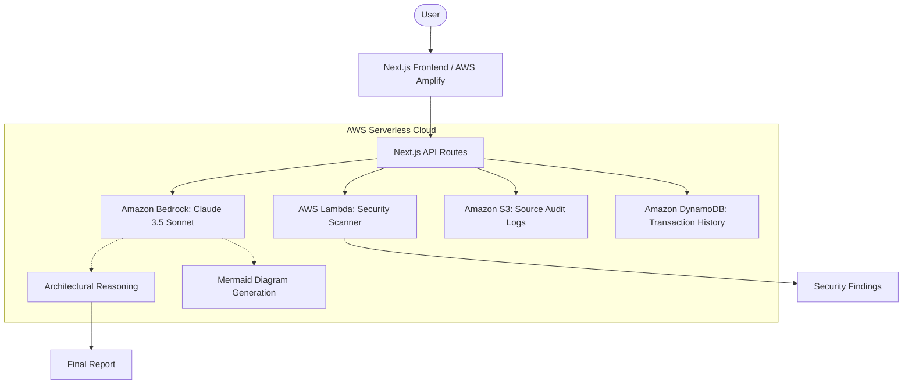

# 🏗️ Arch-Intel & Learning Catalyst

### _The AI-Native Career Intelligence Platform_

**Submission for AWS Hack2skill Hackathon 2026**

[](https://aws.amazon.com/bedrock/)
[](https://nextjs.org/)
[](https://opensource.org/licenses/MIT)

## 🌟 Overview

**Arch-Intel** is a high-performance architectural analysis engine designed for students and developers. It transforms raw source code into high-level architectural insights, security audits, and interactive learning roadmap—all powered by **Amazon Bedrock**.

## 🚀 Core Features

- **Arch-Intel Engine**: Deep structural analysis of code using Claude 3.5 Sonnet.
- **Visual Architecture**: Automatic generation of Mermaid.js diagrams from logic.
- **Socratic Code Mentor**: An AI tutor that guides students using the Socratic method rather than just giving answers.
- **Multilingual Support**: Fully localized in **7 Indian languages** (English, Hindi, Kannada, Tamil, Telugu, Malayalam, Marathi).
- **Security Scanner**: Real-time secret and vulnerability detection via **AWS Lambda**.
- **Financial Simulator**: Projected career growth and salary impact analysis.

## 🏗️ Technical Architecture

The project follows **AWS-native serverless patterns** for maximum scalability and zero-cost idle state (Free Tier Optimized).



## 🛠️ AWS Services Integration (REAL)

- **Amazon Bedrock**: High-reasoning AI via **Amazon Nova Lite** (`amazon.nova-lite-v1:0`).
- **Amazon S3**: Object storage in `your-bucket-name` for code analysis audits.
- **AWS Lambda**: Decoupled compute for security logic (`ArchIntelSecurityScanner`).
- **Amazon DynamoDB**: NoSQL persistence for student history in `YourDynamoTableName`.
- **AWS CDK**: Infrastructure as Code (IaC) in `/cdk` directory.

## 📦 Getting Started

### Prerequisites

- Node.js 18+
- AWS Account with Bedrock Model Access (Claude 3.5 Sonnet)

### Installation

1. Clone the repository:
   ```bash
   git clone [repository-url]
   ```
2. Install dependencies:
   ```bash
   npm install
   ```
3. Configure Environment Variables:
   Create a `.env.local` file:
   ```env
   AWS_REGION=us-east-1
   AWS_ACCESS_KEY_ID=your_access_key
   AWS_SECRET_ACCESS_KEY=your_secret_key
   ```
4. Run locally:
   ```bash
   npm run dev
   ```

## 📝 Submission Checklist (AWS Standards)

- [x] **Generative AI**: Using Amazon Bedrock for core reasoning.
- [x] **Serverless Patterns**: AWS Lambda for security compute.
- [x] **Infrastructure as Code**: AWS CDK implementation in `/cdk`.
- [x] **Managed Services**: Amazon S3 for logging.

---

_Built with ❤️ for the AWS Hackathon._
